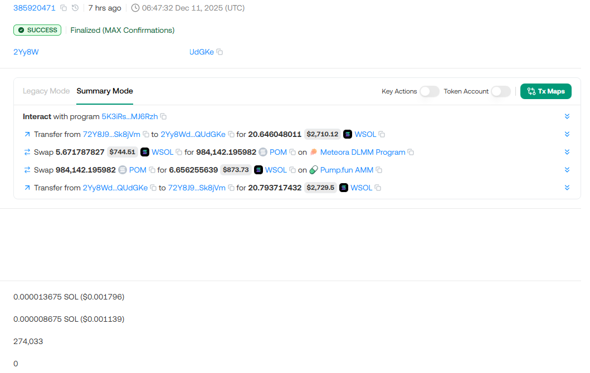

# **ZavodMevBot**
ZavodMevBot — Solana MEV Bot and Automated Solana On-Chain Arbitrage Bot

Documentation:
https://zavod-venture.gitbook.io/zavod-venture-docs/zavod-mev-bot/kak-rabotaet-nash-bot

On-chain program address:
`4Qv3mbzcq1bKmrhGG4voS3EemfPd7f838FLUU7wBHSyi`

**Getting started:** see [HowToRun.MD](./HowToRun.MD).

---

## 🚀 Introduction

**ZavodMevBot** is a fully automated, flash-loan–enabled **Solana on-chain arbitrage bot** written in Rust.

**No need to hunt for arbitrage pairs manually.**
Our ASSIST server watches the whole Solana market and streams profitable arbitrage routes to the bot in real time. The bot decides which routes are worth repeating, builds the transactions and sends them.

**No upfront capital for swaps.**
With flash loans enabled, the swap amount is borrowed and repaid inside the same transaction. You only need SOL for fees and tips.

---

## 💡 Key Features

### **🔍 Multi-DEX routes**

2-hop and 3-hop arbitrage routes across:

- Pump.fun AMM (PumpSwap)
- Meteora DLMM
- Meteora DAMM v2
- Raydium AMM
- Raydium CPMM
- Raydium CLMM
- Orca Whirlpools

### **🧠 Activity windows**

You decide which routes are worth sending and how often: a route is sent while it has enough recent executions and profit in one of your windows. Each window has its own send interval, senders and fees.

### **⚡ Many ways to send**

Every window can send through any mix of:

- your own RPCs (spam)
- Jito and Jito bundles
- Helius and Helius SWQoS
- Temporal, Falcon, Circular, Astralane

Fees can be fixed ranges or **dynamic**: based on what other arbitrage transactions with the same tokens recently paid, within your own limits.

### **📊 Web panel**

A built-in HTTPS panel with a password:

- live dashboard: routes, sends, profit and errors
- statistics of every transaction of your wallet, per window
- configuration page: edit `config.toml` with a description of every setting
- restart, stop and start the bot

### **🔐 Safety**

- Stops, or unwraps WSOL to refill SOL, when the wallet balance gets low
- The wallet key can be encrypted on disk (`encrypt-key`)
- Pool liquidity filters
- Automatic claim of Pump.fun AMM cashback
- Automatic closing of unused empty token accounts to return their rent

---

## 🌊 How **ZavodMevBot** Works

1. **ASSIST streams** arbitrage executions seen on Solana to the bot.
2. **The bot keeps the routes** that pass your activity windows and liquidity filters.
3. **It prepares transactions**: pool accounts, lookup tables, up to 5 pools per transaction.
4. **It sends them** through the window's senders, at the window's interval, with your fees.
5. **The on-chain program** picks the optimal trade size at execution time.
6. **The panel shows** what was sent and what it earned.

The bot can also run without ASSIST, from pool groups listed in a file (file mode).

---

## 🔧 Configuration

Everything is set in `config.toml` (start from `config.toml.example`):

- RPC and wallet
- low-balance stop and WSOL unwrap
- liquidity filters
- activity windows: thresholds, send interval, senders and fees
- sender connections (keys, regions)
- panel

Every setting is described on the panel's configuration page.

---

## 📬 Contact & Support

Have questions or want to know details?

- **Telegram:** [**ZavodMevBot**](https://t.me/ZavodMevBot_Monitor)
